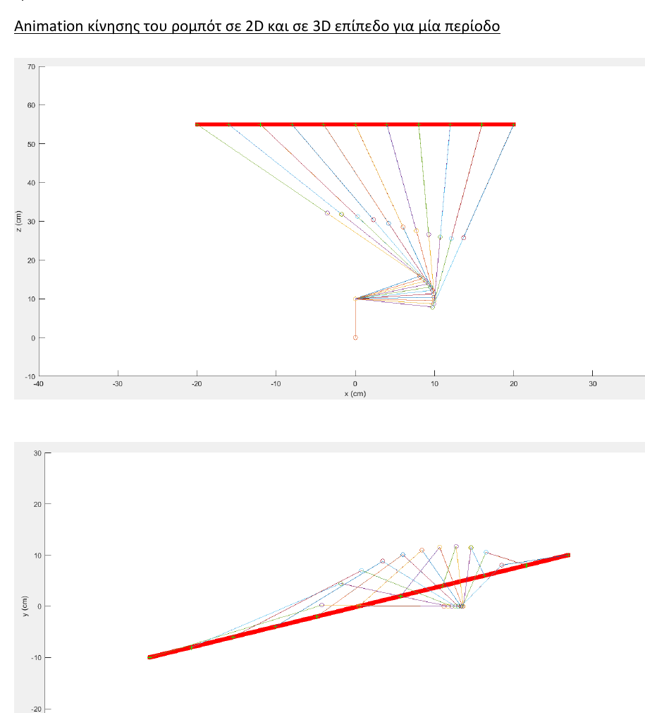
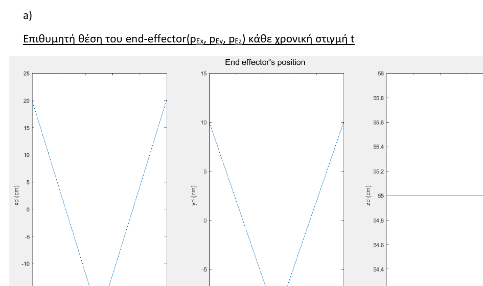
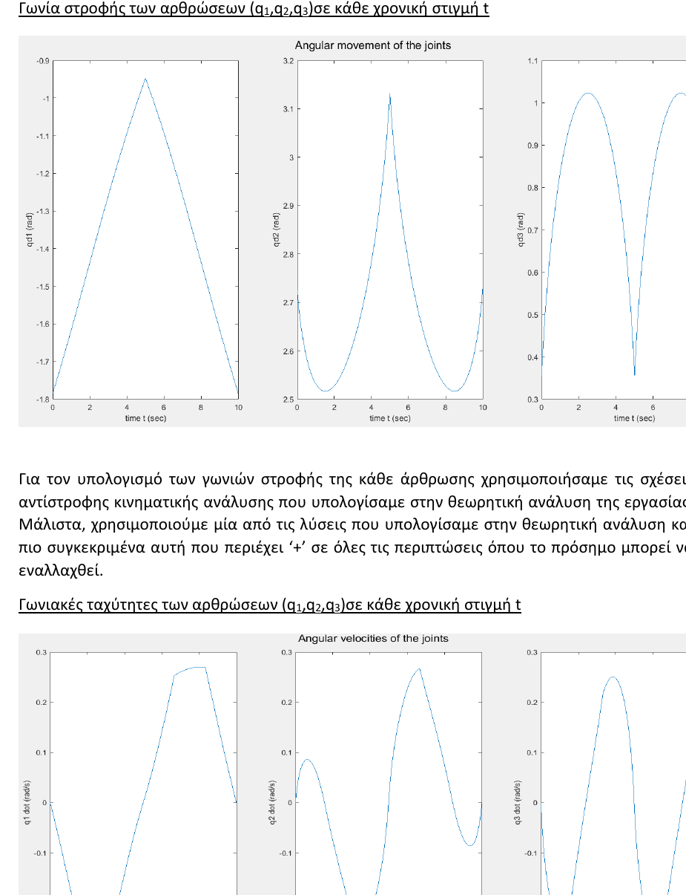

# 3-DOF Robot Manipulator Kinematics - MATLAB

Analytical kinematic modeling and MATLAB simulation of a **three-revolute-joint robotic manipulator**, developed for the **Robotics I: Analysis, Control, Laboratory** course at the School of Electrical and Computer Engineering, National Technical University of Athens (NTUA).

The project connects a complete handwritten kinematic derivation with a numerical MATLAB simulation of the manipulator executing a periodic end-effector trajectory.

  

## Project Overview

The project consists of two connected parts.

### 1. Analytical kinematic modeling

The theoretical analysis derives the kinematic model of a 3-DOF revolute manipulator, including:

- Denavit-Hartenberg frame assignment and parameter table
- homogeneous transformation matrices
- forward kinematics of the end effector
- analytical Jacobian construction
- inverse differential kinematics for end-effector linear velocity
- identification of singular configurations
- inverse geometric kinematics for a desired end-effector position

The complete handwritten derivation is included in `docs/theoretical-analysis.pdf`.

### 2. MATLAB kinematic simulation

The MATLAB implementation uses the derived model to simulate a periodic Cartesian-space motion between two points on a horizontal plane.

For the simulation:

- link dimensions are `l0 = 10 cm`, `l1 = 10 cm`, `l2 = 20 cm`, `l3 = 30 cm`
- the end effector moves from `A = (20, 10, 55) cm` to `B = (-20, -10, 55) cm` and back
- the motion period is `T = 10 s`
- the integration/sampling interval is `dt = 1 ms`
- the z-coordinate remains constant at `55 cm`

A trapezoidal velocity profile is constructed for the moving Cartesian axes, using acceleration, constant-velocity, and deceleration phases.

  

## Kinematic Simulation Pipeline

~~~text
Desired Cartesian trajectory
        ↓
Task-space velocity profile
        ↓
Inverse kinematics
        ↓
Joint angles q1, q2, q3
        ↓
Forward kinematics
        ↓
Manipulator link positions
        ↓
Inverse Jacobian
        ↓
Joint angular velocities
        ↓
2D / 3D motion visualization
~~~

The inverse-kinematics equations used in the MATLAB simulation come directly from the analytical derivation. The joint angular velocities are obtained by applying the inverse of the Jacobian associated with the end-effector linear velocity.

  

## MATLAB Implementation

The main script is:

~~~text
src/robotics_3dof_kinematic_simulation.m
~~~

It performs:

1. manipulator parameter initialization
2. Cartesian trajectory and velocity-profile generation
3. inverse kinematics for the desired joint trajectory
4. forward kinematics for each manipulator link
5. inverse-Jacobian calculation of joint angular velocities
6. plots of Cartesian and joint-space quantities
7. stick-diagram animation in 3D and planar projections

## Running the Simulation

### Requirements

- MATLAB

From the repository root, run:

~~~matlab
run('src/robotics_3dof_kinematic_simulation.m')
~~~

The script generates the trajectory plots and displays successive robot configurations using MATLAB plotting functions.

## Repository Structure

~~~text
3dof-robot-kinematics-matlab/
├── README.md
├── .gitignore
├── src/
│   └── robotics_3dof_kinematic_simulation.m
├── assets/
│   ├── end-effector-position.png
│   ├── joint-kinematics.png
│   └── manipulator-motion.png
└── docs/
    ├── README.md
    ├── course-handout.pdf
    ├── theoretical-analysis.pdf
    └── simulation-report.pdf
~~~

## Documentation

- **Original project specification:** `docs/course-handout.pdf`
- **Handwritten theoretical analysis:** `docs/theoretical-analysis.pdf`
- **MATLAB simulation report:** `docs/simulation-report.pdf`

The public versions of the two personal reports retain the technical content while removing the student registry number and personal email address.

## Notes

A separate two-DOF planar MATLAB example was used as reference during the course but is intentionally not included in this portfolio repository, because the final project concerns the independently developed three-DOF manipulator analysis and simulation.

## Author

**Ioannis Litsos**  
Electrical and Computer Engineering, NTUA
